# Computer Vision Playground: From Basics to Deep Learning

<p align="center">
  
  
  
  
</p>

<p align="center">
  <b>A comprehensive, phase-by-phase journey into Computer Vision.</b><br>
  Covers core pixel manipulations, geometric transformations, spatial filtering, contour analysis, classical Haar cascade detectors, custom color grading, and modern deep-learning object detection with <b>YOLOv8</b>.
</p>

---

## Visual Highlights

### Deep Learning Object Detection (YOLOv8)
Real-time object detection and classification using YOLOv8 models (`yolov8n`, `yolov8m`).

<p align="center">
  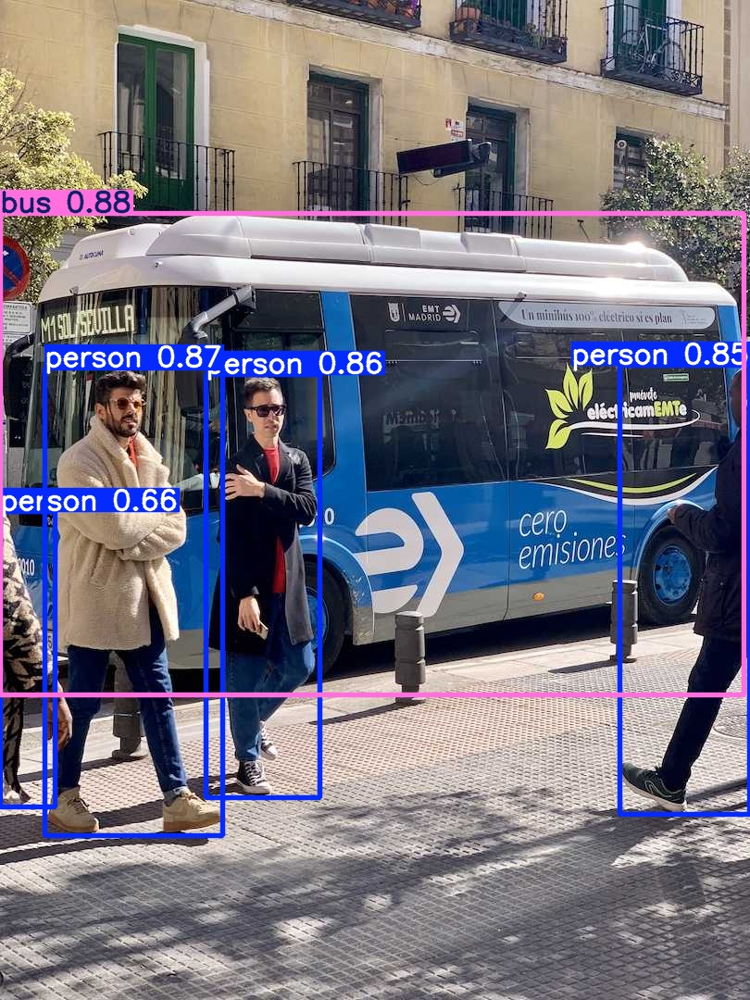
</p>

---

### Color Grading & Unique Tone Conversions
Explore color spaces (HSV, LAB, YCrCb, HLS) and artistic algorithmic transformations.

| Thermal Heatmap | Posterized Colors | Duotone | Sepia Filter | Negative |
| :---: | :---: | :---: | :---: | :---: |
| 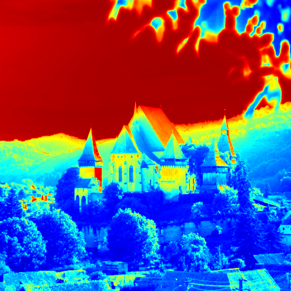 | 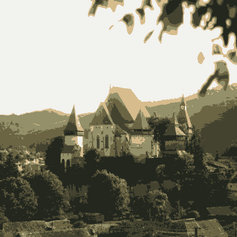 | 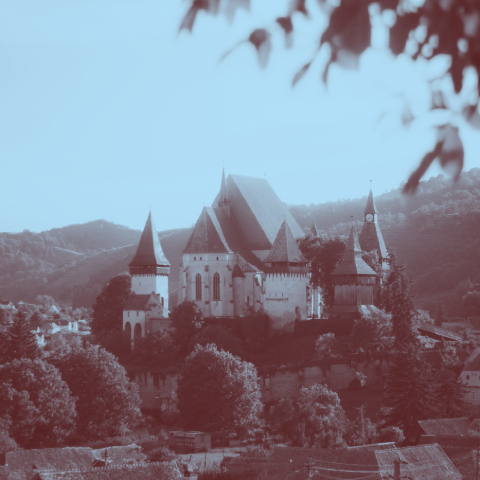 | 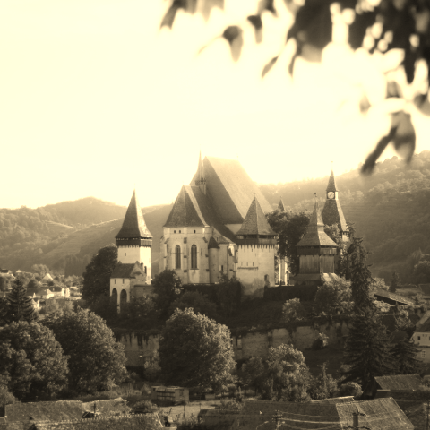 | 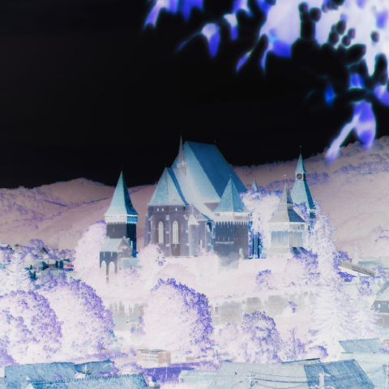 |

---

### RGB Channel Isolation
Isolating individual color channels to understand spectral responses.

| Red Channel Filter | Green Channel Filter | Blue Channel Filter |
| :---: | :---: | :---: |
| 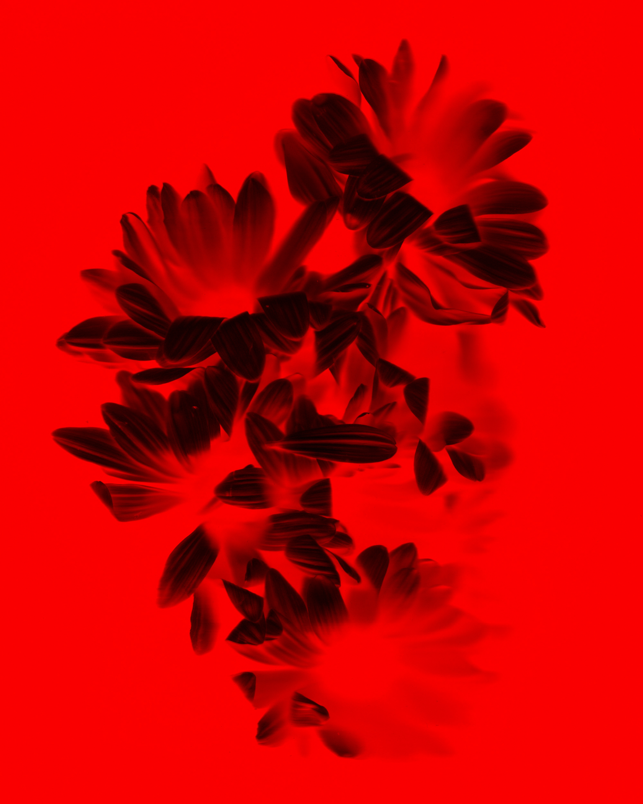 | 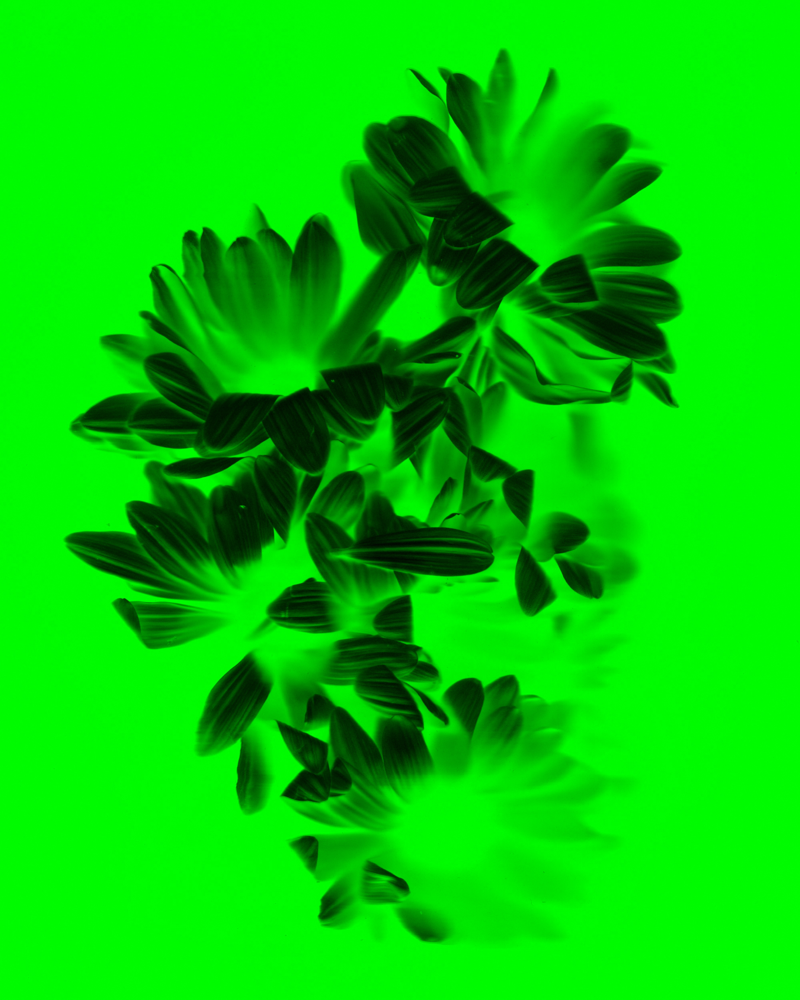 | 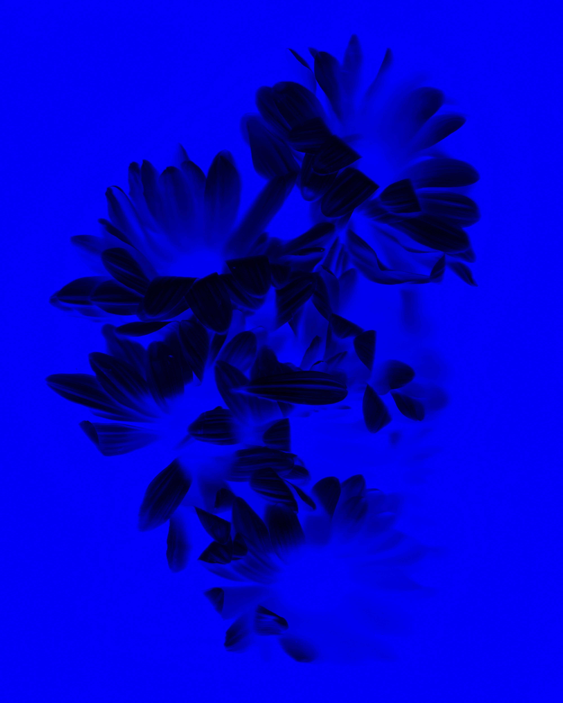 |

---

### Geometric Operations & Annotations
Transforming images and rendering geometric overlays (bounding boxes, circles, lines, text).

| Rotated (45°) | Cropped ROI | Circle Overlay | Rectangle Overlay |
| :---: | :---: | :---: | :---: |
| 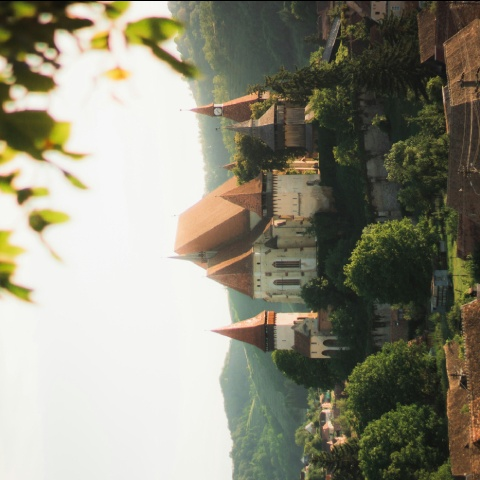 | 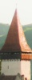 | 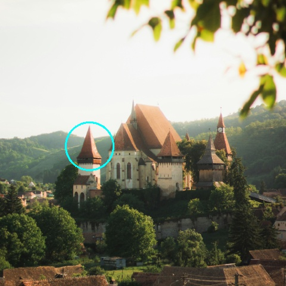 | 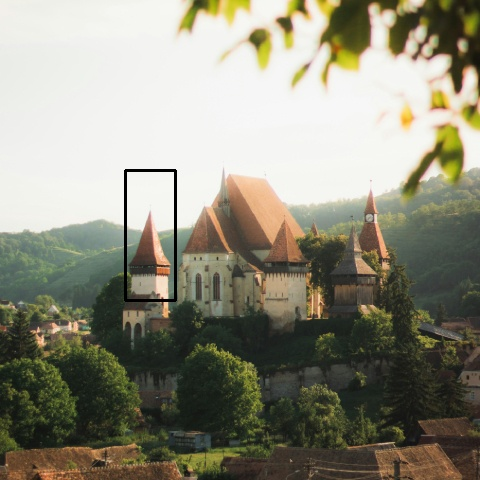 |

---

### Edge Detection & Spatial Filtering
Extracting high-frequency details, gradients, and sharpening images.

| Original / HLS Conversion | Canny Edge Detection | Image Sharpening |
| :---: | :---: | :---: |
| 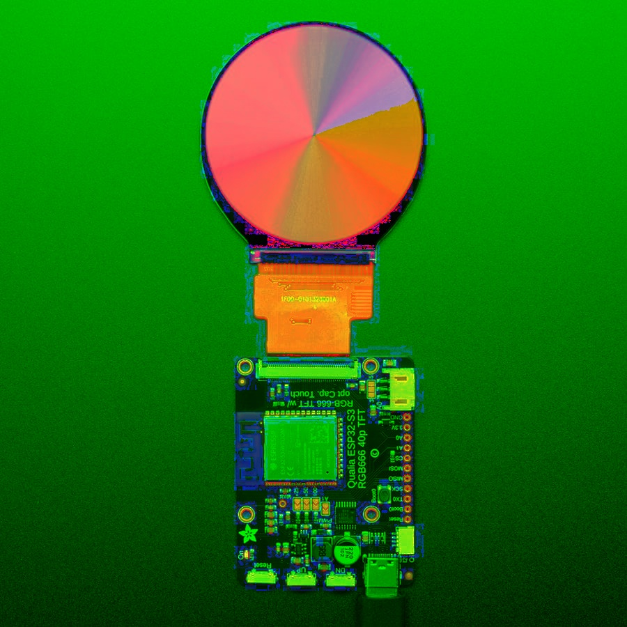 | 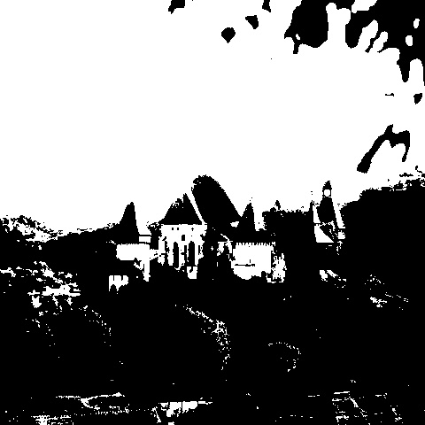 | 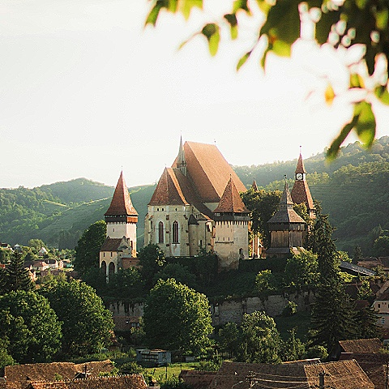 |

---

## Curriculum Roadmap

This repository is structured into distinct sequential phases:

```
├── Phase1: Image Fundamentals
│   ├── 1. image_read.py            # Loading images with cv2.imread
│   ├── 2. image_show.py            # Displaying windows with cv2.imshow
│   ├── 3. image_save.py            # Writing images to disk
│   ├── 4. image_dimension.py       # Matrix shapes, dimensions & channels
│   ├── 5. grayscale_conversion.py  # BGR to Grayscale conversion
│   ├── 6. hls_conversion.py        # HLS color-space mapping
│   ├── 7. Testing(1).py            # Validation script
│   └── 8. Advance_Testing(1).py    # Combined test pipelines
│
├── Phase2: Transformations & Annotations
│   ├── 1. cropping.py              # Array slicing for Region of Interest (ROI)
│   ├── 2. resizing.py              # Interpolation methods (Linear, Cubic, Area)
│   ├── 3. rotation.py              # Affine transformation matrices & cv2.warpAffine
│   ├── 4. fliping.py               # Horizontal, vertical & bilateral flips
│   ├── 5. draw_line.py             # cv2.line drawing primitives
│   ├── 6. draw_rectangle.py        # cv2.rectangle bounding markers
│   ├── 7. draw_circle.py           # cv2.circle drawing primitives
│   └── 8. add_text.py              # cv2.putText overlay styling
│
├── Phase3: Video Streams & Camera IO
│   ├── 1. using_videocap.py        # Webcam capture & frame loops
│   ├── 2. using_YOLO_videocap.py   # Real-time YOLO inference on video feeds
│   └── 3. saving_video.py          # VideoWriter codecs (XVID / MP4V)
│
├── Phase4: Smoothing & Sharpening Filters
│   ├── 1. gaussian_blur.py         # Gaussian kernel convolution & noise reduction
│   ├── 2. median_blur.py           # Salt-and-pepper noise removal
│   └── 3. image_sharpening.py      # Kernel convolution for edge accentuation
│
├── Phase5: Edges, Thresholding & Bitwise Operations
│   ├── 1. canny_edge_detection.py  # Multi-stage Canny gradient edge detector
│   ├── 2. threshold_func.py        # Binary, Otsu, and adaptive thresholding
│   └── 3. bitwise_operations.py    # AND, OR, XOR, and NOT mask operations
│
├── Phase6: Contours & Shape Recognition
│   ├── 1. contour_func.py          # cv2.findContours & hierarchy analysis
│   └── 2. approxPolyDP_func.py     # Douglas-Peucker polygon approximation
│
├── Phase7: Classical Object & Face Detection
│   ├── face.py                     # Haar Cascade frontal face detection
│   ├── all_detection.py            # Multi-cascade pipeline (Face, Eyes, Smile)
│   └── haarcascades/               # Pretrained XML cascade models
│
├── PlaywithYOLO: Deep Learning Object Detection
│   └── BasicYOLO/yolo_webcam.py    # YOLOv8 live webcam detection
│
├── RGB_Colors: Channel Decomposition
│   ├── red.py / green.py / blue.py # Single channel isolation & thresholding
│
└── cv_utils.py                     # Production-ready reusable CV toolkit
```

---

## Reusable Toolkit: `cv_utils.py`

A standalone helper library included in the root directory for computer vision workflows:

* **Letterboxing & Resizing**: `letterbox()`, `resize_keep_aspect()`, `resize_to_fit()`
* **Bounding Box Geometry**: `calculate_iou()`, `calculate_iou_matrix()`, `xyxy_to_xywh()`, `xywh_to_xyxy()`, `clip_boxes()`
* **Detection Post-Processing**: `non_max_suppression()`
* **Visual Annotations**: `draw_boxes()`, `draw_center()`, `draw_grid()`, `put_text()`
* **Video & Performance**: `FPS()`, `Timer()`, `open_video()`, `read_video_frames()`, `make_mosaic()`

---

## Getting Started

### 1. Prerequisites & Installation

Clone this repository and set up a virtual environment:

```bash
git clone https://github.com/hasheramin5-cyber/PlayingwithCV.git
cd PlayingwithCV
```

Create a virtual environment and install dependencies:

```bash
python -m venv .venv
# Windows:
.venv\Scripts\activate
# Linux/macOS:
source .venv/bin/activate

pip install opencv-python numpy ultralytics
```

### 2. Running the Scripts

* **Run YOLOv8 Object Detection on an Image:**
  ```bash
  yolo predict model=yolov8n.pt source=bus.jpg show=True
  ```

* **Run Real-Time Webcam Detection:**
  ```bash
  python PlaywithYOLO/BasicYOLO/yolo_webcam.py
  ```

* **Run Face & Facial Feature Detection:**
  ```bash
  python Phase7/all_detection.py
  ```

* **Generate All Color & Artistic Variations:**
  ```bash
  python color_variations.py
  python unique_color_versions.py
  ```

---

## Tech Stack

* **Language**: Python 3.9+
* **Libraries**: OpenCV (`cv2`), Ultralytics YOLOv8, NumPy
* **Models**: YOLOv8 Nano (`yolov8n.pt`), Medium (`yolov8m.pt`), Haar Cascades
